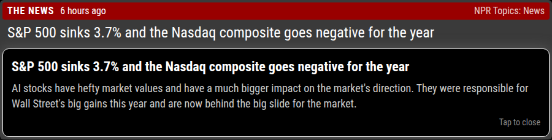

# MMM-Ticknews

A news ticker for [MagicMirror²](https://github.com/MagicMirrorOrg/MagicMirror). It shows one
headline at a time from any news feeds you like, with how long ago it was posted and where it came
from. On a touch mirror, tap a headline to read its summary or if you have a custom css file in the css
directory you can just add
```js
html {
  cursor: auto;
}
```
 and your mouse will work.  If you don't just add custom.css then put that in it.  Reboot.

## Screenshots

Eight color themes, picked with the `css` option:

| Theme | Looks like |
|---|---|
| `plain` |  |
| `red` |  |
| `blue` |  |
| `orange` |  |
| `gold` |  |
| `black` |  |
| `green` |  |
| `lblue` |  |

Tap a headline to read its summary:



---

## Requirements

- MagicMirror² 2.3x (Node 18 or newer)
- An internet connection. Works with any RSS or Atom news feed. No account or API key needed.

## Install

```bash
cd ~/MagicMirror/modules
git clone https://github.com/cowboysdude/MMM-Ticknews
```

**Do I need to run `npm install`?** No. The module has no dependencies.

## Add it to your config

In `~/MagicMirror/config/config.js`, inside `modules: [ ... ]`:

```js
{
  module: "MMM-Ticknews",
  position: "bottom_bar",
  config: {
    css: "red",
    urls: [
      "https://feeds.npr.org/1001/rss.xml",
      "https://rss.nytimes.com/services/xml/rss/nyt/HomePage.xml"
    ]
  }
},
```

Restart MagicMirror to see it. Leave out `urls` and it shows NPR's top stories.

`bottom_bar` or `lower_third` work best, since headlines can be long.

## Options

| Option | Default | What it does |
|---|---|---|
| `urls` | NPR top stories | The news feeds to read, as a list: `["feed 1", "feed 2"]`. Any RSS or Atom feed works. Headlines from all feeds are mixed together, and the same story from two feeds only shows once. |
| `css` | `"plain"` | Color theme: `plain`, `red`, `blue`, `orange`, `gold`, `black`, `green` or `lblue` (see the screenshots). |
| `articles` | `50` | Up to how many headlines to keep, from all feeds together. |
| `random` | `true` | `true` shows headlines in random order. `false` shows the newest first. |
| `rotateInterval` | `10000` (10 seconds) | How long each headline stays up, in milliseconds. |
| `updateInterval` | `900000` (15 minutes) | How often to get fresh news, in milliseconds. |
| `showSource` | `true` | Show which feed the headline came from. |
| `timeAgo` | theme color | Color of the "2 hours ago" text, for example `"white"`. |
| `readInterval` | `30000` (30 seconds) | A tapped summary closes on its own after this long. |
| `maxWidth` | `"950px"` | How wide the ticker can get. |

### Some feeds to try

| Feed | Address |
|---|---|
| NPR top stories | `https://feeds.npr.org/1001/rss.xml` |
| New York Times | `https://rss.nytimes.com/services/xml/rss/nyt/HomePage.xml` |
| BBC News | `https://feeds.bbci.co.uk/news/rss.xml` |

Most news sites have one. Look for "RSS" on the site.

### Voice control

If you use a voice module, it can send `SHOW_ARTICLE` to open the summary of the current headline
and `HIDE_ARTICLE` to close it.

## Troubleshooting

| What you see | What to do |
|---|---|
| "News not available right now" | Check the mirror's internet connection and the feed addresses. It keeps trying on its own. |
| One feed's headlines never show | That feed address may be wrong or retired. Any feed that fails is skipped and logged in the MagicMirror log. |
| `add at least one feed to urls` | `urls` must be a list, like `urls: ["https://feeds.npr.org/1001/rss.xml"]`. |

## What changed in v2

- Works again with current MagicMirror. The old version crashed on start.
- No more `npm install`. The old `request`, `rss-combiner` and `xml2js` packages are gone.
- Color themes load properly again. All 8 are now in one file.
- Random order really is random now, and duplicate stories from different feeds are dropped.
- Tapping a headline shows its summary. The old version tried to open the whole web page inside the
  mirror, which most news sites block.
- New: works with Atom feeds too, shows the feed name, and has a working default feed.

## Credits

Created by **cowboysdude**. Voice control idea by STIGH. MIT License.
